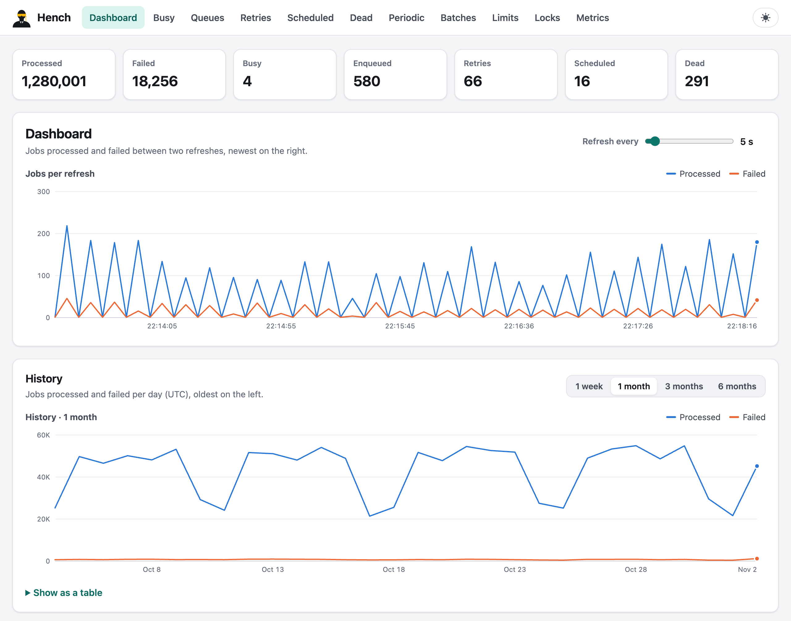

<div align="center">


<p><strong>Background jobs for Rust, built on Sidekiq's battle-tested design.</strong><br>
Reliable by default: running jobs survive a crashed process.</p>

<p>
<a href="https://crates.io/crates/hench"></a>
<a href="https://docs.rs/hench"></a>
<a href="https://codecov.io/gh/rkwap/hench"></a>
<a href="#minimum-supported-rust-version"></a>
<a href="https://github.com/rkwap/hench/blob/v0.1.0/LICENSE"></a>
</p>

<p>
<a href="https://github.com/rkwap/hench/blob/v0.1.0/docs/guide/getting-started.md">Getting started</a> ·
<a href="https://github.com/rkwap/hench/blob/v0.1.0/docs/guide/README.md">Guide</a> ·
<a href="https://docs.rs/hench">API reference</a> ·
<a href="https://github.com/rkwap/hench/blob/v0.1.0/benchmarks/README.md">Benchmarks</a> ·
<a href="https://github.com/rkwap/hench/blob/v0.1.0/CHANGELOG.md">Changelog</a>
</p>

</div>

Hench runs background jobs for [tokio] applications. Jobs are typed Rust functions, queues live
in Redis, and the architecture, data model and semantics are those of [Sidekiq] 8.1, the job
system that has carried some of the busiest Ruby applications for more than a decade. Its Pro
and Enterprise features and its dashboard come included.

<picture>
  <source media="(prefers-color-scheme: dark)" srcset="https://github.com/rkwap/hench/raw/v0.1.0/docs/assets/dashboard-dark.png">
  
</picture>

## Highlights

- **Typed jobs.** An `async fn` with `#[hench::job]` is a job. Its arguments are serde types,
  checked when you push; a panic is an ordinary failure that never takes a worker down.
- **Nothing lost.** Reliable fetch keeps each running job in its process's in-progress list until
  it is acknowledged, so a crashed process loses nothing. Outcomes are written through Redis
  outages, and moves between queues and sets are atomic scripts.
- **Sidekiq's model, kept.** Queues are Redis lists; retries, scheduled and dead jobs are sorted
  sets; processes report through heartbeats. The data layout, the retry formula, the quiet/stop
  lifecycle and the dashboard follow Sidekiq, and its test scenarios are ported one by one.
- **Pro and Enterprise features built in.** Unique jobs, periodic (cron) jobs, batches and
  workflows, rate limiting and throttles, iterable jobs and pausable queues.
- **Operable.** A dashboard you mount in axum or run with the `hench` command, a JSON API,
  execution metrics, testing modes that need no Redis, systemd integration.
- **Fast per process.** On Sidekiq's own load benchmark, against the same Redis, a Hench process
  runs no-op jobs 2.8 times as fast as Sidekiq 8.1 (4.8 times with basic fetch), and its
  dashboard serves pages 1.7 to 2.0 times as fast. With a millisecond between the process and
  Redis, Hench leads at 100 threads; at 30, basic fetch keeps pace with Sidekiq and reliable
  fetch, which waits for two Redis round trips per job against one, runs at half its speed
  ([Performance](#performance)).

## Quick start

Hench needs Redis 6.2 or newer, or Valkey. Add it with tokio:

```toml
[dependencies]
hench = "0.1"
tokio = { version = "1", features = ["macros", "rt-multi-thread", "net"] }
tracing-subscriber = { version = "0.3", features = ["env-filter"] }
# Optional: the dashboard, served by your axum application.
hench-web = "0.1"
axum = "0.8"
```

Define a job, push it, and run workers:

```rust,no_run
use hench::prelude::*;
use tracing_subscriber::EnvFilter;

/// Sends the welcome email of a new user. Retried up to 5 times if it fails.
#[hench::job(queue = "mailers", retry = 5)]
async fn welcome_email(user_id: i64) -> Result<(), std::io::Error> {
    println!("welcome, user {user_id}!");
    Ok(())
}

#[tokio::main]
async fn main() -> Result<(), Box<dyn std::error::Error>> {
    // Logs at `info` unless RUST_LOG says otherwise: job starts, ends and failures.
    tracing_subscriber::fmt()
        .with_env_filter(EnvFilter::try_from_default_env().unwrap_or_else(|_| "info".into()))
        .init();
    let hench = Hench::builder()
        .redis_url("redis://127.0.0.1:6379")
        .queues(["mailers", "default"])
        .build()
        .await?;
    // Enqueue from anywhere that has a client...
    welcome_email::perform_async(hench.client(), (42,)).await?;
    // ...and process jobs until SIGINT or SIGTERM.
    hench.run().await?;
    Ok(())
}
```

The [getting started guide][guide-start] goes on from here: job options, scheduled and bulk
pushes, worker processes, and workers running next to an axum application.

## The dashboard

`hench-web` is the dashboard as an `axum::Router`: mount it in your application, behind your
own authentication.

```rust,no_run
use hench::prelude::*;
use hench_web::HenchWeb;

#[tokio::main]
async fn main() -> Result<(), Box<dyn std::error::Error>> {
    let hench = Hench::builder().redis_url("redis://127.0.0.1:6379").build().await?;
    let app = axum::Router::new().nest_service("/jobs", hench_web::router(HenchWeb::new(&hench)));
    let listener = tokio::net::TcpListener::bind("127.0.0.1:3000").await?;
    axum::serve(listener, app).await?;
    Ok(())
}
```

Or run it on its own, with Basic authentication and a JSON API, through the `hench` command:

```sh
cargo install hench-server --locked
hench web --bind 127.0.0.1:7420
```

It shows live and historical statistics, busy processes, queues, retries, scheduled and dead
jobs with bulk actions, periodic schedules, batches, rate limits, unique-job locks and metrics
charts, in light and dark themes. See [the dashboard][guide-dashboard] and
[the `hench` command][guide-cli].

## Performance

Sidekiq ships its benchmark scripts with the gem. [`benchmarks/`][benchmarks] ports each of
them to Hench, and runs both on the same machine against the same Redis. On an AWS EC2
c7i.4xlarge (Intel Xeon Platinum 8488C, Redis 8.10.3, Sidekiq 8.1.7 on Ruby 4.0.9 with YJIT),
medians of five runs, with ratios to Sidekiq:

| Benchmark | Sidekiq 8.1.7 (free) | Hench, basic fetch | **Hench, default** (reliable fetch) |
|---|---:|---:|---:|
| **Running jobs survive a crash** | ✗ | ✗ | **✓** as in Sidekiq Pro |
| One process runs 500,000 no-op jobs, 10 threads | 23,449 jobs/s | 113,051 (4.8×) | 65,450 (2.8×) |
| The same, 1 ms from Redis, 30 threads | 21,155 jobs/s | 20,765 (1.0×) | 10,933 (0.5×) |
| The same, 1 ms from Redis, 100 threads | 20,106 jobs/s | 47,381 (2.4×) | 27,739 (1.4×) |
| 8 processes drain 8 queues of 1,000,000 jobs | 126,482 jobs/s | 163,510 (1.3×) | 97,552 (0.8×) |
| Dashboard, `/busy` page | 894 requests/s | | 1,508 (1.7×) |
| Dashboard, `/queues` page | 1,409 requests/s | | 2,777 (2.0×) |

**Reading the table.** Free Sidekiq takes each job off the queue, so a job running in a process
that crashes is lost. Hench's basic fetch works the same way: compare those two columns like for
like. Hench's default, reliable fetch, keeps each job in Redis until it is done, so a crash loses
nothing. That is the guarantee of Sidekiq Pro's paid `super_fetch` (not measured here), and it
costs a second Redis round trip per job: with Redis on the same machine, Hench's default still
runs 2.8 times as fast as free Sidekiq, and with a millisecond between them it trails at 30
threads and leads at 100 ([why][benchmarks-latency]). Draining queues with eight processes, where
Redis is the bottleneck, it costs Redis two commands per job against one.

## Features

| Area | What you get |
|---|---|
| **Jobs** | `#[hench::job]` functions or `impl Job` types; per-job queue, retries, backtraces, tags and log level ([guide][guide-jobs]) |
| **Pushes** | now, after a delay, at a time, or in bulk spread over an interval; raw pushes by class name ([guide][guide-push]) |
| **Workers** | any concurrency; capsules with their own queues; strict, weighted or random queue order; pausable queues ([guide][guide-config]) |
| **Retries** | exponential backoff with jitter, `retry_in` and `retries_exhausted` hooks, a dead set trimmed by age and size ([guide][guide-retries]) |
| **Delivery** | reliable fetch with orphan recovery and poison-pill detection, or basic fetch; graceful shutdowns that requeue ([guide][guide-delivery]) |
| **Unique jobs** | one waiting or running copy per job and arguments, debouncing, locks released with the outcome ([guide][guide-unique]) |
| **Periodic jobs** | cron expressions or intervals, in time zones, one push per tick across processes without a leader ([guide][guide-periodic]) |
| **Batches** | callbacks when a group of jobs completes or succeeds, nested batches, cancellation, staged workflows ([guide][guide-batches]) |
| **Rate limiting** | concurrent, window, bucket, leaky and points limiters inside jobs; throttles on job starts; limits on whole queues, checked when workers fetch ([guide][guide-limits]) |
| **Iterable jobs** | long jobs that save their cursor and resume after a stop, a failure or a deploy ([guide][guide-iterable]) |
| **Observability** | execution metrics and histograms per job class, deploy marks, `tracing` spans per job ([guide][guide-metrics]) |
| **Testing** | fake and inline clients that need no Redis, a private `redis-server` per integration test ([guide][guide-testing]) |
| **Operations** | the dashboard, the `hench` command and JSON API, systemd notify and watchdog, TLS, Unix sockets, Sentinel ([guide][guide-deploy]) |

## Documentation

- **[The guide][guide]**: from a first job to production, a page per topic.
- **[API reference](https://docs.rs/hench)**: every type and option.
- **[Differences from Sidekiq][guide-sidekiq]**: what carries over and what Hench does
  differently.
- **[Design][design]**: the contract behind the code (the Redis data model, the semantics, and
  every deviation from Sidekiq).
- **[Benchmarks][benchmarks]**, the **[roadmap][roadmap]** and the **[changelog][changelog]**.

The workspace has four crates:

| Crate | What it is |
|---|---|
| [`hench`][dir-hench] | The library: client, jobs, workers, data API, metrics, iterable jobs, testing. |
| [`hench-macros`][dir-hench-macros] | The `#[hench::job]` attribute (re-exported by `hench`). |
| [`hench-web`][dir-hench-web] | The dashboard, as an `axum::Router`. |
| [`hench-server`][dir-hench-server] | The `hench` binary: standalone dashboard, JSON API and CLI. |

## Minimum supported Rust version

Rust 1.88, edition 2024.

## Contributing

Bug reports, documentation and code are welcome: [CONTRIBUTING.md][contributing] explains how to
propose a change and what a pull request needs. Report security issues privately, as
[SECURITY.md][security] describes. Everyone taking part follows the
[code of conduct][code-of-conduct].

## License and credits

Hench is licensed under the [MIT license][license].

Hench is inspired by [Sidekiq] by Mike Perham and Contributed Systems: its architecture, data
model, semantics and dashboard structure follow Sidekiq's, and its tests port the scenarios of
Sidekiq's test suite. Hench contains no Sidekiq code: Sidekiq is LGPL-3.0 licensed, and Hench
is an independent implementation written from its documented behaviour. Thanks also to
[rusty-sidekiq] and [Faktory] for ideas, and to [BullMQ], [Oban], [sidekiq-unique-jobs],
[sidekiq-cron], [sidekiq-batch] and [sidekiq-throttled], whose documented semantics, reported
problems and test scenarios shaped the unique, periodic, batch and rate limiting features. Hench
is not affiliated with or endorsed by Contributed Systems or by any of these projects.

[tokio]: https://tokio.rs
[Sidekiq]: https://github.com/sidekiq/sidekiq
[rusty-sidekiq]: https://github.com/film42/sidekiq-rs
[Faktory]: https://github.com/contribsys/faktory
[BullMQ]: https://github.com/taskforcesh/bullmq
[Oban]: https://github.com/oban-bg/oban
[sidekiq-unique-jobs]: https://github.com/mhenrixon/sidekiq-unique-jobs
[sidekiq-cron]: https://github.com/sidekiq-cron/sidekiq-cron
[sidekiq-batch]: https://github.com/breamware/sidekiq-batch
[sidekiq-throttled]: https://github.com/ixti/sidekiq-throttled
[guide]: https://github.com/rkwap/hench/blob/v0.1.0/docs/guide/README.md
[guide-start]: https://github.com/rkwap/hench/blob/v0.1.0/docs/guide/getting-started.md
[guide-jobs]: https://github.com/rkwap/hench/blob/v0.1.0/docs/guide/jobs.md
[guide-push]: https://github.com/rkwap/hench/blob/v0.1.0/docs/guide/jobs.md#enqueuing-jobs
[guide-config]: https://github.com/rkwap/hench/blob/v0.1.0/docs/guide/configuration.md
[guide-retries]: https://github.com/rkwap/hench/blob/v0.1.0/docs/guide/reliability.md
[guide-delivery]: https://github.com/rkwap/hench/blob/v0.1.0/docs/guide/reliability.md#delivery-guarantees-reliable-and-basic-fetch
[guide-unique]: https://github.com/rkwap/hench/blob/v0.1.0/docs/guide/unique-jobs.md
[guide-periodic]: https://github.com/rkwap/hench/blob/v0.1.0/docs/guide/periodic-jobs.md
[guide-batches]: https://github.com/rkwap/hench/blob/v0.1.0/docs/guide/batches.md
[guide-limits]: https://github.com/rkwap/hench/blob/v0.1.0/docs/guide/rate-limiting.md
[guide-iterable]: https://github.com/rkwap/hench/blob/v0.1.0/docs/guide/iterable-jobs.md
[guide-metrics]: https://github.com/rkwap/hench/blob/v0.1.0/docs/guide/metrics.md
[guide-testing]: https://github.com/rkwap/hench/blob/v0.1.0/docs/guide/testing.md
[guide-dashboard]: https://github.com/rkwap/hench/blob/v0.1.0/docs/guide/dashboard.md
[guide-cli]: https://github.com/rkwap/hench/blob/v0.1.0/docs/guide/cli.md
[guide-deploy]: https://github.com/rkwap/hench/blob/v0.1.0/docs/guide/deployment.md
[guide-sidekiq]: https://github.com/rkwap/hench/blob/v0.1.0/docs/guide/sidekiq.md
[design]: https://github.com/rkwap/hench/blob/v0.1.0/docs/DESIGN.md
[benchmarks]: https://github.com/rkwap/hench/blob/v0.1.0/benchmarks/README.md
[benchmarks-latency]: https://github.com/rkwap/hench/blob/v0.1.0/benchmarks/README.md#why-hench-falls-behind-with-latency
[roadmap]: https://github.com/rkwap/hench/blob/v0.1.0/docs/ROADMAP.md
[changelog]: https://github.com/rkwap/hench/blob/v0.1.0/CHANGELOG.md
[license]: https://github.com/rkwap/hench/blob/v0.1.0/LICENSE
[contributing]: https://github.com/rkwap/hench/blob/v0.1.0/CONTRIBUTING.md
[security]: https://github.com/rkwap/hench/blob/v0.1.0/SECURITY.md
[code-of-conduct]: https://github.com/rkwap/hench/blob/v0.1.0/CODE_OF_CONDUCT.md
[dir-hench]: https://github.com/rkwap/hench/tree/v0.1.0/crates/hench
[dir-hench-macros]: https://github.com/rkwap/hench/tree/v0.1.0/crates/hench-macros
[dir-hench-web]: https://github.com/rkwap/hench/tree/v0.1.0/crates/hench-web
[dir-hench-server]: https://github.com/rkwap/hench/tree/v0.1.0/crates/hench-server
