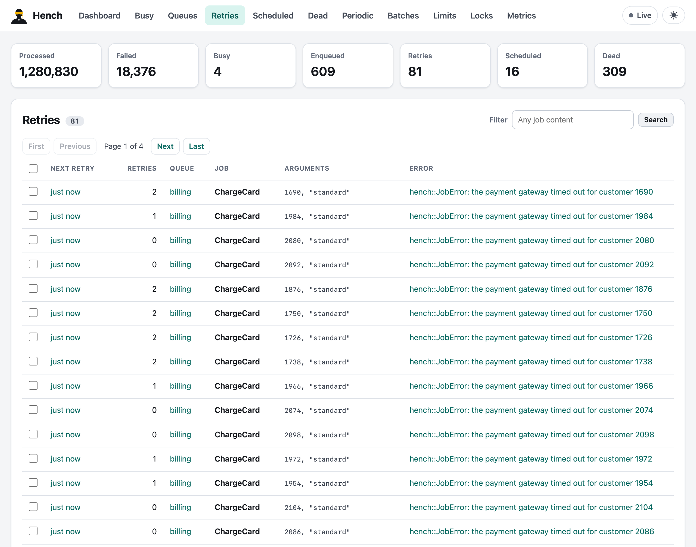
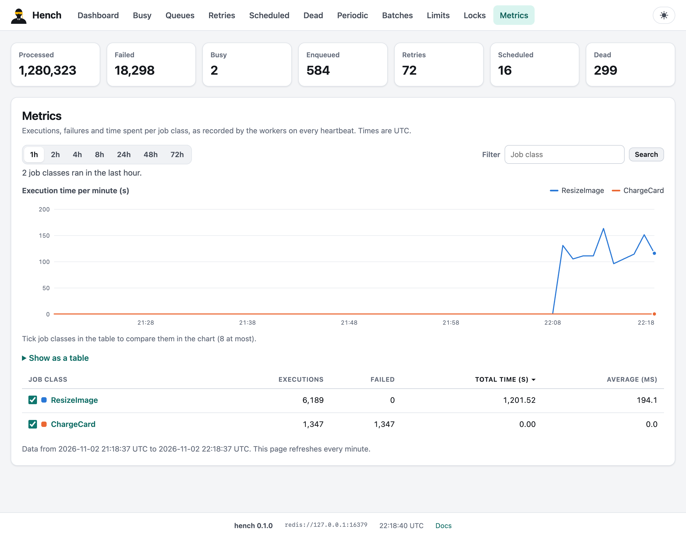

# The dashboard

`hench-web` is the dashboard as an `axum::Router`. Mount it anywhere, behind your own
authentication:

```rust,no_run
use std::time::Duration;

use axum::extract::Request;
use axum::middleware::{self, Next};
use axum::response::{IntoResponse, Response};
use hench_web::{AllowedHosts, HenchWeb};

async fn admins_only(request: Request, next: Next) -> Response {
    // Check your session cookie here, or a header your proxy sets (and strips from what
    // clients send).
    if request.headers().contains_key("x-admin") {
        next.run(request).await
    } else {
        axum::http::StatusCode::UNAUTHORIZED.into_response()
    }
}

#[tokio::main]
async fn main() -> Result<(), Box<dyn std::error::Error>> {
    let redis = hench::RedisPool::connect("redis://127.0.0.1:6379").await?;
    let dashboard = HenchWeb::new(&redis)
        .title("Acme jobs")
        .app_url("/admin")              // a "Back to app" link
        .tab("Reports", "/admin/reports") // extra navigation tabs
        .poll_interval(Duration::from_secs(3))
        // The names it is reached under, besides localhost and IP addresses.
        .allowed_hosts(AllowedHosts::new(["jobs.example.com"]))
        .read_only(false);              // true: no buttons, every POST refused
    let app = axum::Router::new()
        .nest_service("/jobs", hench_web::router(dashboard).layer(middleware::from_fn(admins_only)));
    let listener = tokio::net::TcpListener::bind("127.0.0.1:3000").await?;
    axum::serve(listener, app).await?;
    Ok(())
}
```

| Retries, with each job's error | Execution metrics per job class |
|---|---|
|  |  |

Pages: the dashboard (live chart, history, Redis), busy processes (quiet and stop them),
queues (pause, resume, set or clear their limits, delete, browse, filter), retries, scheduled and dead jobs (filter,
retry, enqueue now, delete, kill, in bulk or all at once), each job in detail (arguments,
error and backtrace, iteration progress, and its batch, schedule, lock and limits), and the
tabs of the features: periodic schedules (enqueue now, pause, resume, delete), batches
(cancel, delete, skip a job, push callbacks), limits (reset, clear a wait line) and the locks
of unique jobs (release one, a selection or all); then metrics. `.periodic(false)`,
`.batches(false)`, `.limits(false)`, `.locks(false)` and `.metrics(false)` turn a tab off: it
disappears and its pages answer 404. `hench-web`'s crate documentation lists every route,
with the ones that take actions (all `POST`, all refused by `.read_only(true)`), for a proxy
that filters paths. `HenchWeb::new(&hench)` uses the application's client middleware,
dead-set limits and death handlers for the actions. Pages of your own go inside it, like
Sidekiq's web extensions:
`.routes(router)` serves your routes behind the dashboard's protections, where
`hench_web::Page` renders them in its layout and `hench_web::Form` reads their forms with its
CSRF check; `.job_info(..)` adds rows, such as a link to a job's logs, to the job pages.

The dashboard answers only requests addressed to `localhost`, an IP address or a name given
to `allowed_hosts`: otherwise a web page on another site could point its own host name at
your machine (DNS rebinding) and use a dashboard listening on `127.0.0.1` as if it were its
own, CSRF token included. `AllowedHosts::any()` serves every name, for a dashboard whose every
request is authenticated with credentials such a page cannot use (a session cookie, HTTP
Basic); `hench_web::require_host` applies the same check to routes of your own. Every change
is a POST protected by a CSRF token and fetch-metadata checks; pages carry a
strict content security policy (no inline scripts or styles), `nosniff`, `same-origin`
referrers and frame protection; everything is escaped; the assets are embedded in the binary
and served with content hashes. It works at the root, nested several levels deep and under
paths with parameters, in light and dark themes, down to phone widths. Mount it with
`nest_service`, which serves both `/jobs` and `/jobs/` (axum's `nest` does not route
`/jobs/`).

---

[← Using the features together](combining-features.md) · [Guide](README.md) · [The `hench` command →](cli.md)
